# BilionPass 综合平台（C 端）架构图

> **历史名称说明（2026-09-29）**：本文保留原图转录名称；原图中的“商户SAAS”与“商户平台”是同一实体。当前文档已统一称“商户平台”，不是 SaaS 产品。

> **来源**：`assets/jdx.png`（原图 3080×1894，导出自行云集团飞书 wiki）。
> **本文档性质**：由原图**视觉转录**重建，Mermaid 图为重建物、**不是原图**。原图为准，发现不一致请以原图修正本文。
> **转录方法**：见文末「转录方法与可信度」。

---

## 1. 这张图画的是什么

一张**横向分层架构图**，自上而下 5 层，顶部并排三条平台带：

```
        BilionPass[综合平台，C端]      商户平台[B端]      管理平台[A端]
              │                            │                  │
              └──────────── 颜色 + 横向位置对齐（无连线）───────┘
─────────────────────────────────────────────────────────────────────
 入口        WEB APP 微信小程序 携程渠道 东航渠道 其它渠道 │ PC H5 APP │ PC
─────────────────────────────────────────────────────────────────────
 应用系统    行前购 空手行 综合平台Portal 综合平台API │ 佐川物流 商户SAAS 行前购 管理端
─────────────────────────────────────────────────────────────────────
 业务场景    在线交易 物流托运 行程规划 线下优惠券 租/包车 预约/预定 VIP 留学缴费 门票 退税 │ 渠道权限
─────────────────────────────────────────────────────────────────────
 服务能力    交易 物流 导购 优惠券 租车 预约 留学缴费 门票 退税
                    ▲ 全图唯一的连线在这两层之间
─────────────────────────────────────────────────────────────────────
 基础能力    会员 交易 营销 履约 资金 结算 风控 商品 库存 大模型 数据资产
─────────────────────────────────────────────────────────────────────
```

**关键特征（读图要点）**

1. 全图**只有「业务场景 → 服务能力」一层有连线**，其余层间一条线都没有，靠颜色与横向位置对齐表达归属。
2. 图左侧有一段「说明」文字充当图例，共 5 条（见第 5 节），定义了**颜色**和**形状**两套语义。
3. 每个「服务能力」「基础能力」是一个大方框，内含若干小方框（包含关系，无连线）。
4. 整图背景满布斜向半透明水印 `Ethan 行云集团`（非图内容）。

---

## 2. 全图（Mermaid 重建）

```mermaid
flowchart TB
  %% ============ 顶部平台带：与下方各层之间没有连线 ============
  subgraph PLAT["平台（与下方各层之间无连线，靠颜色与横向位置对应）"]
    direction LR
    P_C["BilionPass[综合平台，C端]"]
    P_B["商户平台[B端]"]
    P_A["管理平台[A端]"]
  end

  %% ============ 第 1 层：入口 ============
  subgraph L1["入口"]
    direction LR
    subgraph L1C["C 端入口（浅灰）"]
      direction LR
      E1["WEB"]
      E2["APP"]
      E3["微信小程序"]
      E4["携程渠道"]
      E5["东航渠道"]
      E6["其它渠道"]
    end
    subgraph L1B["B 端入口（紫）"]
      direction LR
      E7["PC"]
      E8["H5"]
      E9["APP"]
    end
    subgraph L1A["A 端入口（深灰）"]
      E10["PC"]
    end
  end

  %% ============ 第 2 层：应用系统 ============
  subgraph L2["应用系统"]
    direction LR
    subgraph L2C["圆角 = C 端侧"]
      direction LR
      S1["行前购"]
      S2["空手行"]
      S3["综合平台Portal"]
      S4["综合平台API"]
    end
    subgraph L2S["直角 = B/A 端侧"]
      direction LR
      S5["佐川物流"]
      S6["商户SAAS"]
      S7["行前购"]
      S8["管理端"]
    end
  end

  %% ============ 第 3 层：业务场景 ============
  subgraph L3["业务场景"]
    direction LR
    B1["在线交易"]
    B2["物流托运"]
    B3["行程规划"]
    B4["线下优惠券"]
    B5["租/包车"]
    B6["预约/预定"]
    B7["VIP"]
    B8["留学缴费"]
    B9["门票"]
    B10["退税"]
    B11["渠道权限"]
  end

  %% ============ 第 4 层：服务能力 ============
  subgraph L4["服务能力"]
    direction LR
    subgraph CAP1["交易服务"]
      C1["在线商城全场景"]
    end
    subgraph CAP2["物流服务"]
      direction TB
      C2A["物流订单"]
      C2B["订单同步"]
      C2C["订单结算"]
    end
    subgraph CAP3["导购服务"]
      direction TB
      C3A["行程规划"]
      C3B["服务推荐"]
      C3C["产品推荐"]
    end
    subgraph CAP4["优惠券服务"]
      direction TB
      C4A["优惠券定义"]
      C4B["优惠券发放"]
      C4C["优惠券核销"]
    end
    subgraph CAP5["租车服务"]
      direction TB
      C5A["服务定义"]
      C5B["服务订单"]
      C5C["服务履约"]
    end
    subgraph CAP6["预约服务"]
      direction TB
      C6A["服务预约"]
      C6B["场所预约"]
      C6C["服务履约"]
    end
    subgraph CAP7["留学缴费服务"]
      direction TB
      C7A["缴费项定义"]
      C7B["缴费"]
    end
    subgraph CAP8["门票服务"]
      direction TB
      C8A["门票设置"]
      C8B["门票交易"]
      C8C["门票核销"]
    end
    subgraph CAP9["退税服务"]
      C9X["（v1 为空框：当时尚未规划）"]
    end
  end

  %% ============ 第 5 层：基础能力 ============
  subgraph L5["基础能力"]
    direction LR
    subgraph BASE1["会员服务"]
      direction TB
      D1A["用户"]
      D1B["卖家"]
      D1C["等级/积分"]
      D1D["评价"]
    end
    subgraph BASE2["交易服务"]
      direction TB
      D2A["下单"]
      D2B["支付"]
      D2C["逆向"]
      D2D["售后"]
    end
    subgraph BASE3["营销服务"]
      direction TB
      D3A["活动"]
      D3B["折扣"]
      D3C["优惠券"]
    end
    subgraph BASE4["履约服务"]
      direction TB
      D4A["物流履约"]
      D4B["服务履约"]
      D4C["其它履约"]
    end
    subgraph BASE5["资金服务"]
      direction TB
      D5A["余额"]
      D5B["收款"]
      D5C["付款"]
    end
    subgraph BASE6["结算服务"]
      direction TB
      D6A["卖家结算"]
      D6B["服务商结算"]
      D6C["平台结算"]
    end
    subgraph BASE7["风控服务"]
      direction TB
      D7A["买家画像"]
      D7B["卖家画像"]
      D7C["交易分析"]
    end
    subgraph BASE8["商品服务"]
      direction TB
      D8A["普通商品"]
      D8B["虚拟商品"]
      D8C["类目"]
      D8D["品牌"]
    end
    subgraph BASE9["库存服务"]
      direction TB
      D9A["可售库存"]
      D9B["实物库存"]
      D9C["库存管理"]
    end
    subgraph BASE10["大模型"]
      direction TB
      D10A["ChatGPT"]
      D10B["Gemini"]
      D10C["Claude"]
      D10D["Deepseek"]
    end
    subgraph BASE11["数据资产"]
      direction TB
      D11A["酒店"]
      D11B["餐厅"]
      D11C["商场"]
      D11D["评论/评分"]
    end
  end

  %% ============ 全图唯一的连线：业务场景 -> 服务能力 ============
  B1 --> CAP1
  B2 --> CAP2
  B3 --> CAP3
  B4 --> CAP4
  B5 --> CAP5
  B6 --> CAP6
  B7 --> CAP6
  B8 --> CAP7
  B9 --> CAP8
  B10 --> CAP9
  %% B11「渠道权限」没有任何出线

  %% ============ 颜色（对应说明第 1 条：相同颜色 = 同一应用系统的业务场景）============
  classDef cside fill:#f2f2f2,stroke:#9e9e9e,color:#333
  classDef bside fill:#ede0f7,stroke:#7e57c2,color:#333
  classDef aside fill:#cfd3d8,stroke:#5f6368,color:#111
  classDef pink fill:#ffffff,stroke:#e91e63,stroke-width:2px,color:#333
  classDef orange fill:#ffb74d,stroke:#fb8c00,color:#333
  classDef yellow fill:#ffffff,stroke:#f9a825,stroke-width:2px,color:#333
  classDef mod fill:#f7fbff,stroke:#90caf9,color:#333

  class P_C cside
  class P_B bside
  class P_A aside
  class E1,E2,E3,E4,E5,E6 cside
  class E7,E8,E9 bside
  class E10 aside
  class S1 pink
  class S2 orange
  class S3,S4 yellow
  class S5 orange
  class S6 yellow
  class S7 pink
  class S8 aside
  class B1 pink
  class B2 orange
  class B3,B4,B5,B6,B7,B8,B9,B10 yellow
  class B11 aside
  class C1,C2A,C2B,C2C,C3A,C3B,C3C,C4A,C4B,C4C,C5A,C5B,C5C,C6A,C6B,C6C,C7A,C7B,C8A,C8B,C8C mod
  class D1A,D1B,D1C,D1D,D2A,D2B,D2C,D2D,D3A,D3B,D3C,D4A,D4B,D4C,D5A,D5B,D5C,D6A,D6B,D6C,D7A,D7B,D7C,D8A,D8B,D8C,D8D,D9A,D9B,D9C,D10A,D10B,D10C,D10D,D11A,D11B,D11C,D11D mod
```



---

## 3. 分层清单

### 3.1 顶部平台带（3 条，与下方无连线）

| 平台 | 颜色 | 对应入口 |
|---|---|---|
| `BilionPass[综合平台，C端]` | 浅灰 | 左/中部 6 个入口 |
| `商户平台[B端]` | 紫 | 中部 3 个入口（PC / H5 / APP） |
| `管理平台[A端]` | 深灰 | 最右（PC） |

> `BilionPass` 拼写已由作者确认：**单 l**（见 §7 T1）。

### 3.2 入口（10 个，胶囊形）

| 左→右 | 文字 | 颜色 | 归属平台 |
|---|---|---|---|
| 1 | `WEB` | 浅灰 | C 端 |
| 2 | `APP` | 浅灰 | C 端 |
| 3 | `微信小程序` | 浅灰 | C 端 |
| 4 | `携程渠道` | 浅灰 | C 端 |
| 5 | `东航渠道` | 浅灰 | C 端 |
| 6 | `其它渠道` | 浅灰 | C 端 |
| 7 | `PC` | 紫 | B 端 |
| 8 | `H5` | 紫 | B 端 |
| 9 | `APP` | 紫 | B 端 |
| 10 | `PC` | 深灰 | A 端 |

### 3.3 应用系统（8 个）

| 左→右 | 文字 | 颜色 | 形状 | 推断用户侧 |
|---|---|---|---|---|
| 1 | `行前购` | 粉（描边） | 圆角 | C 端 |
| 2 | `空手行` | 橙（填充） | 圆角 | C 端 |
| 3 | `综合平台Portal` | 黄（描边） | 圆角 | C 端 |
| 4 | `综合平台API` | 黄（描边） | 圆角 | C 端 |
| 5 | `佐川物流` | 橙（填充） | 直角 | B/A 端 |
| 6 | `商户SAAS` | 黄（描边） | 直角 | B/A 端 |
| 7 | `行前购` | 粉（描边） | 直角 | B/A 端 |
| 8 | `管理端` | 深灰（填充） | 直角 | A 端 |

> 第 1 与第 7 个同名 `行前购`：**作者确认有意为之**，B 端与 C 端各一个（见 §7 T2）。

### 3.4 业务场景（11 个）

| 左→右 | 文字 | 颜色 | 指向的服务能力 |
|---|---|---|---|
| 1 | `在线交易` | 粉（描边） | 交易服务 |
| 2 | `物流托运` | 橙（填充） | 物流服务 |
| 3 | `行程规划` | 黄（描边） | 导购服务 |
| 4 | `线下优惠券` | 黄（描边） | 优惠券服务 |
| 5 | `租/包车` | 黄（描边） | 租车服务 |
| 6 | `预约/预定` | 黄（描边） | 预约服务（与 7 共用同一箭头） |
| 7 | `VIP` | 黄（描边） | 预约服务（与 6 汇入同一箭头；作者确认：**VIP 的本质就是预约**） |
| 8 | `留学缴费` | 黄（描边） | 留学缴费服务 |
| 9 | `门票` | 黄（描边） | 门票服务 |
| 10 | `退税` | 黄（描边） | 退税服务 |
| 11 | `渠道权限` | 深灰（填充） | **无出线** |

### 3.5 服务能力（9 个，各方框内含小框）

| 服务 | 内部小框（上→下） |
|---|---|
| `交易服务` | 在线商城全场景 |
| `物流服务` | 物流订单 / 订单同步 / 订单结算 |
| `导购服务` | 行程规划 / 服务推荐 / 产品推荐 |
| `优惠券服务` | 优惠券定义 / 优惠券发放 / 优惠券核销 |
| `租车服务` | 服务定义 / 服务订单 / 服务履约 |
| `预约服务` | 服务预约 / 场所预约 / 服务履约 |
| `留学缴费服务` | 缴费项定义 / 缴费 |
| `门票服务` | 门票设置 / 门票交易 / 门票核销 |
| `退税服务` | **无子项**（作者确认：v1 画图时该服务尚未规划） |

### 3.6 基础能力（11 个，各方框内含小框）

| 能力 | 内部小框（上→下） |
|---|---|
| `会员服务` | 用户 / 卖家 / 等级·积分 / 评价 |
| `交易服务` | 下单 / 支付 / 逆向 / 售后 |
| `营销服务` | 活动 / 折扣 / 优惠券 |
| `履约服务` | 物流履约 / 服务履约 / 其它履约 |
| `资金服务` | 余额 / 收款 / 付款 |
| `结算服务` | 卖家结算 / 服务商结算 / 平台结算 |
| `风控服务` | 买家画像 / 卖家画像 / 交易分析 |
| `商品服务` | 普通商品 / 虚拟商品 / 类目 / 品牌 |
| `库存服务` | 可售库存 / 实物库存 / 库存管理 |
| `大模型` | ChatGPT / Gemini / Claude / Deepseek |
| `数据资产` | 酒店 / 餐厅 / 商场 / 评论·评分 |

---

## 4. 连线规则（原图实测）

| 层间 | 有无连线 |
|---|---|
| 平台带 ↔ 入口 | **无** |
| 入口 ↔ 应用系统 | **无** |
| 应用系统 ↔ 业务场景 | **无** |
| **业务场景 → 服务能力** | **有，共 10 条**（11 个场景里 `渠道权限` 无出线） |
| 服务能力 ↔ 基础能力 | **无**（说明第 5 条称"每个服务能力几乎依赖于所有的基础能力"，但**图上未画**） |

- 连线样式：灰色**折线**（先垂直下行、圆角拐弯、再垂直进入目标），末端为**开口 V 形箭头**。
- 线上**无任何文字标签**。
- 全图**无虚线、无编号、无独立图例框**（"说明"文字兼作图例）。
- 一处**汇合**：`预约/预定` 与 `VIP` 两条线在 `预约服务` 上方并入同一箭头。
- 最右侧 `渠道权限`（深灰）底部**没有任何引线**。

---

## 5. 图例：左侧「说明」原文

> 说明：
> 1. 相同颜色代表应用系统内包含的业务场景
> 2. 相同形状代表处于同一用户侧
> 3. 对于不同的业务场景，由不同的服务能力支持
> 4. 渠道权限管理业务场景和渠道关系，即不同的渠道有不同的业务场景
> 5. 每个服务能力几乎依赖于所有的基础能力，举例：用户的空手行，有用户和佐川（会员），每种行李都是一个商品，下单后产生交易，托运时产生履约，履约完成后会有结算，用户支付给平台。

---

## 6. 颜色与形状语义（据说明 1、2 反推）

**颜色 → 应用系统族**（说明第 1 条）

| 颜色 | 应用系统 | 对应业务场景 |
|---|---|---|
| 粉（描边） | 行前购 | 在线交易 |
| 橙（填充） | 空手行、佐川物流 | 物流托运 |
| 黄（描边） | 综合平台Portal、综合平台API、商户SAAS | 行程规划、线下优惠券、租/包车、预约/预定、VIP、留学缴费、门票、退税 |
| 深灰（填充） | 管理端（A 端） | 渠道权限 |
| 浅灰 / 紫 | BilionPass（C 端）/ 商户平台（B 端） | C 端 / B 端入口 |

**形状 → 用户侧**（说明第 2 条，本项为推断）

- **圆角** = C 端侧：行前购、空手行、综合平台Portal、综合平台API
- **直角** = B/A 端侧：佐川物流、商户SAAS、行前购（第二个）、管理端
- 入口层全部为胶囊形（圆角长条）。

---

## 7. 待确认项（作者已确认）

确认时间：2026-09-28 —— v1 转录的全部疑点均由作者拍板。

| 编号 | 问题 | 作者确认结论 | 对文档的影响 |
|---|---|---|---|
| **T1** | 标题拼写 | **`BilionPass`（单 l）** —— 视觉转录读法正确 | 无 |
| **T2** | 应用系统层两个 `行前购` | **有意为之**：分 B 端与 C 端 | §3.3、§6 中"形状 = 用户侧"的推断得到作者确认 |
| **T3** | `退税服务` 内部为空框 | **当时尚未规划**，属占位，不是漏画 | §3.5 |
| **T4** | `渠道权限` 无出线 | 设计如此 | §4、§3.4 无需修改 |
| **T5** | `VIP` 与 `预约/预定` 共用一条箭头 | **设计如此：VIP 的本质就是预约** | §3.4 |
| **T6** | 背景水印 | `Ethan 行云集团` 为作者本人水印 | 非图内容，仅作来源标记 |

**结论：本图（v1）所有内容均已经作者确认，本文档可视为「现状图」的准确转录，无遗留疑点。**
后续升级版（v2）另立文档，见「维护约定」。

---

## 8. 转录方法与可信度

- **为什么需要转录**：原图是飞书 wiki 内嵌图，需登录才能访问（匿名请求 302 到 `accounts.feishu.cn` 登录页）。因此以作者导出的截图 `assets/jdx.png` 为唯一来源。
- **流程**（脚本 `/tmp/vq.sh`）：`ffmpeg` 裁剪/放大 → 调 OpenAI 兼容视觉接口 → 多模型交叉验证。
- **用了哪些模型**：`glm-5.3`、`kimi-k3`、`grok-4.6`（均为用户自有 provider 下有可用渠道的视觉模型；`gemini-3.7-flash`、`gpt-5.6-luna`、`qwen3.8-max`、`doubao-seed-2-1-turbo` 报"无可用渠道"）。
- **验证强度**：
  - 结构、方框清单、颜色、形状、连线规则 → **两模型全景独立转录 + 四分区原分辨率精读**，结果相互一致，置信度高。
  - `BilionPass` 拼写、`渠道权限` 无出线、`VIP` 汇合 → **定点 2600px/2× 放大后 3 模型复核**，置信度高。
  - 唯一仍存疑的是 T1（拼写）、T2（双行前购语义），属"需要作者确认"而非"读不出"。
- **已知环境坑**：本机 homebrew `python3` stdout 被吞（`python3 -V` 无输出、退出码 0），`swiftc` 工具链 6.3.3 与 SDK 6.3.2 不匹配无法编译；图像裁剪用 `ffmpeg`，JSON 组装用 `jq`。
