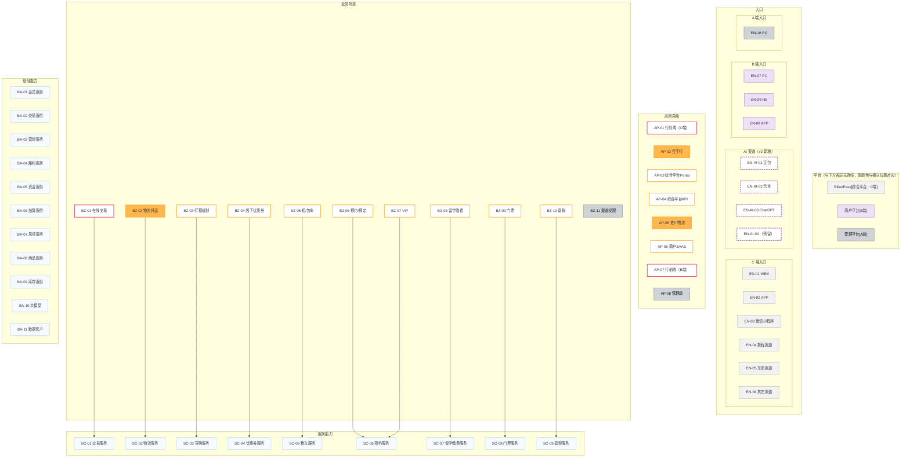

# BilionPass 架构图 v2 · 总览

> 版本：v2（批次 0）｜日期：2026-09-28｜基线：v1 = `assets/jdx.png`（`docs/bilionpass-architecture.md` 是其完整转录）
> 设计规格：`docs/superpowers/specs/2026-09-28-bilionpass-v2-design.md`｜决策记录：`docs/v2-decisions.md`

## 1. 这套文档怎么读

| 顺序 | 文件 | 回答什么 |
|---|---|---|
| 0 | 本文档 | 全局骨架、ID 坐标、图例 |
| 1 | `01-业务视图.md` | 用户从哪些入口进来、走哪些场景、由哪些系统承载 |
| 2 | `02-能力视图.md` | 场景由哪些服务能力支撑、服务能力又依赖哪些基础能力 |
| 3 | `03-关系矩阵.md` | 上面两张图没画全的关系，逐格可查 |
| 4 | `blocks/*.md`（批次 1 起） | 每一块的详细讲解 |

**ID 是唯一坐标。** 讨论、画图、写文档、开会指认，一律用 ID（如"`SC-02` 的履约依赖"）。v1 里有几个名字重复的格子（两个"行前购"、两个"交易服务"），只有 ID 能区分。

**`?` 的含义**：本文档体系里 `?` 一律表示"**待作者确认**"，不是"没有"。凡是 `?` 的地方都是我不猜的空白，分布在矩阵里与图注中。

**两种看图方式**：① 文档里的 Mermaid 图（进 git、可 diff、可机械校验）；② `assets/v2/*.png` 位图（由 `tools/build-pretty.mjs` 从同一份事实来源渲染，给汇报/发同事用）。两者同源，改数据只需改本文档与 `03-关系矩阵.md`。

## 2. v2 相对 v1 的变更

| 变更 | v1 | v2 |
|---|---|---|
| 入口层 | 10 个入口 | 10 个 + **4 个 AI 渠道**（豆包 / 元宝 / ChatGPT / 预留位），虚线框标记 |
| 格子标识 | 无 | **每格带 ID**，全仓库唯一 |
| 线型语义 | 只有实线 | 实线 = 已确立关系；**虚线箭头 = v2 新增的依赖关系（强度见 M3）**；**虚线边框 = AI 渠道** |
| `渠道权限` | 只说"管理渠道与场景关系" | 图注明确"**机制保留、当前全开**"（作者确认：所有渠道都能卖全部场景） |
| 服务能力↔基础能力 | 只在"说明"第 5 条里用一句话提到，图上**一条线都没有** | 图 2 画**关键链路**，全量关系落 **M3 矩阵** |
| 跨端共用 | 无处可查 | **M4 矩阵**（业务场景 × 用户侧） |
| 子项位置 | 全塞在一页大图 | **下沉到图 2**；L0 总图只到格子级，一页可读、能当索引 |
| 输出形态 | 只有飞书里的一张图 | Mermaid 源 + **`assets/v2/*.png` 位图**（Chrome 渲染，3520×2944 @2x） |
| 退税服务 | 空框 | 仍为空框，图注写明"v1 画图时该服务尚未规划" |

## 3. ID 注册表（唯一事实来源）

> 图、矩阵、文档、位图全部从这张表派生。改 ID 只能改这里，然后跑 `node tools/check-ids.mjs` 验证全仓库一致。

### 3.1 入口层 `EN`（14 个）

顺序与 v1 一致：C 端 1–6、B 端 7–9、A 端 10；AI 渠道用独立编号段插在 C 端之后，**不移动既有编号、不留空号**。

| ID | 名称 | 用户侧 | 颜色 | 备注 |
|---|---|---|---|---|
| EN-01 | WEB | C 端 | 浅灰 | |
| EN-02 | APP | C 端 | 浅灰 | |
| EN-03 | 微信小程序 | C 端 | 浅灰 | |
| EN-04 | 携程渠道 | C 端 | 浅灰 | OTA 渠道 |
| EN-05 | 东航渠道 | C 端 | 浅灰 | OTA 渠道 |
| EN-06 | 其它渠道 | C 端 | 浅灰 | 用户侧已知（C 端），**落地系统 `?`**（U7） |
| EN-AI-01 | 豆包 | C 端 | 浅灰 + 虚线框 | **v2 新增** |
| EN-AI-02 | 元宝 | C 端 | 浅灰 + 虚线框 | **v2 新增** |
| EN-AI-03 | ChatGPT | C 端 | 浅灰 + 虚线框 | **v2 新增** |
| EN-AI-04 | （预留） | C 端 | 浅灰 + 虚线框 | **v2 新增**，占位，标注"预留" |
| EN-07 | PC | B 端 | 紫 | |
| EN-08 | H5 | B 端 | 紫 | |
| EN-09 | APP | B 端 | 紫 | |
| EN-10 | PC | A 端 | 深灰 | |

### 3.2 应用系统 `AP`（8 个）

| ID | 名称 | 用户侧 | 颜色族 | 形状 |
|---|---|---|---|---|
| AP-01 | 行前购 | C 端 | 粉 | 圆角 |
| AP-02 | 空手行 | C 端 | 橙 | 圆角 |
| AP-03 | 综合平台Portal | C 端 | 黄 | 圆角 |
| AP-04 | 综合平台API | C 端 | 黄 | 圆角 |
| AP-05 | 佐川物流 | **`?`** | 橙 | 直角 |
| AP-06 | 商户SAAS | B 端 | 黄 | 直角 |
| AP-07 | 行前购 | B 端 | 粉 | 直角 |
| AP-08 | 管理端 | A 端 | 深灰 | 直角 |

> `AP-05` 的用户侧是 `?`：它按 v1 形状规则（直角 = B/A 端侧）应属 B/A 侧，但同色族的 `AP-02` 空手行是 C 端圆角，两者不能同时成立。作者拍板前不写成既成事实（U1）。

### 3.3 业务场景 `BZ`（11 个）

> **"承载用户侧"一列是推论，口径由颜色族决定**：与某个业务场景同色的应用系统分布在哪些用户侧，该场景就承载哪些用户侧。这一列必须与 `03-关系矩阵.md` 的 **M4** 完全一致。

| ID | 名称 | 颜色族 | 承载用户侧 | 依据 |
|---|---|---|---|---|
| BZ-01 | 在线交易 | 粉 | C 端 / B 端 | 粉族 = `AP-01`(C) + `AP-07`(B) |
| BZ-02 | 物流托运 | 橙 | C 端 / **`?`** | 橙族 = `AP-02`(C) + `AP-05`(`?`)，随 U1 |
| BZ-03 | 行程规划 | 黄 | C 端 / B 端 | 黄族 = `AP-03`/`AP-04`(C) + `AP-06`(B) |
| BZ-04 | 线下优惠券 | 黄 | C 端 / B 端 | 同上 |
| BZ-05 | 租/包车 | 黄 | C 端 / B 端 | 同上 |
| BZ-06 | 预约/预定 | 黄 | C 端 / B 端 | 同上 |
| BZ-07 | VIP | 黄 | C 端 / B 端 | 同上 |
| BZ-08 | 留学缴费 | 黄 | C 端 / B 端 | 同上 |
| BZ-09 | 门票 | 黄 | C 端 / B 端 | 同上 |
| BZ-10 | 退税 | 黄 | C 端 / B 端 | 同上 |
| BZ-11 | 渠道权限 | 深灰 | A 端 | 深灰 = `AP-08`(A) |

### 3.4 服务能力 `SC`（9 个）

| ID | 名称 | 内部子项（v1 原文） |
|---|---|---|
| SC-01 | 交易服务 | 在线商城全场景 |
| SC-02 | 物流服务 | 物流订单 / 订单同步 / 订单结算 |
| SC-03 | 导购服务 | 行程规划 / 服务推荐 / 产品推荐 |
| SC-04 | 优惠券服务 | 优惠券定义 / 优惠券发放 / 优惠券核销 |
| SC-05 | 租车服务 | 服务定义 / 服务订单 / 服务履约 |
| SC-06 | 预约服务 | 服务预约 / 场所预约 / 服务履约 |
| SC-07 | 留学缴费服务 | 缴费项定义 / 缴费 |
| SC-08 | 门票服务 | 门票设置 / 门票交易 / 门票核销 |
| SC-09 | 退税服务 | （空框：v1 画图时尚未规划） |

### 3.5 基础能力 `BA`（11 个）

| ID | 名称 | 内部子项（v1 原文） |
|---|---|---|
| BA-01 | 会员服务 | 用户 / 卖家 / 等级·积分 / 评价 |
| BA-02 | 交易服务 | 下单 / 支付 / 逆向 / 售后 |
| BA-03 | 营销服务 | 活动 / 折扣 / 优惠券 |
| BA-04 | 履约服务 | 物流履约 / 服务履约 / 其它履约 |
| BA-05 | 资金服务 | 余额 / 收款 / 付款 |
| BA-06 | 结算服务 | 卖家结算 / 服务商结算 / 平台结算 |
| BA-07 | 风控服务 | 买家画像 / 卖家画像 / 交易分析 |
| BA-08 | 商品服务 | 普通商品 / 虚拟商品 / 类目 / 品牌 |
| BA-09 | 库存服务 | 可售库存 / 实物库存 / 库存管理 |
| BA-10 | 大模型 | ChatGPT / Gemini / Claude / Deepseek |
| BA-11 | 数据资产 | 酒店 / 餐厅 / 商场 / 评论·评分 |

## 4. L0 总图

**定义**：平台带 + 5 层共 6 个纵向区块；粒度**只到格子级**（53 格：入口 14 + 应用系统 8 + 业务场景 11 + 服务能力 9 + 基础能力 11），**不画子项**（子项下沉到图 2）；每格标 ID；保留 v1 那条唯一的 `BZ → SC` 实线作为与 v1 的连续性锚点。

**与图 1/图 2 的关系**：**并列**，不是包含关系。L0 = 骨架与索引；图 1 = 业务侧深入；图 2 = 能力侧深入。



## 5. 图例 v2

### 5.1 颜色 = 应用系统族（沿用 v1 说明第 1 条）

| 颜色 | 应用系统 | 对应业务场景 |
|---|---|---|
| 粉 | `AP-01` / `AP-07` 行前购 | `BZ-01` 在线交易 |
| 橙 | `AP-02` 空手行、`AP-05` 佐川物流 | `BZ-02` 物流托运 |
| 黄 | `AP-03` 综合平台Portal、`AP-04` 综合平台API、`AP-06` 商户SAAS | `BZ-03` ~ `BZ-10` |
| 深灰 | `AP-08` 管理端 | `BZ-11` 渠道权限 |
| 浅灰 | C 端入口（`EN-01` ~ `EN-06`、`EN-AI-*`）、BilionPass 平台带 | — |
| 紫 | B 端入口（`EN-07` ~ `EN-09`）、商户平台带 | — |

### 5.2 形状 = 用户侧（沿用 v1 说明第 2 条）

- **圆角** = C 端侧（`AP-01` ~ `AP-04`）
- **直角** = B / A 端侧（`AP-05` ~ `AP-08`；其中 `AP-05` 因 U1 存疑）
- 入口层全部为胶囊形；**AI 渠道用虚线边框**，与 OTA 渠道区分

### 5.3 线型与边框

| 记号 | 含义 | 出现处 |
|---|---|---|
| 实线箭头 | 已确立的确定关系 | `BZ → SC`（L0、图 2） |
| 虚线箭头 | **v2 新增的依赖关系**——v1 图上完全没有这层；具体强度（强/弱）**看 M3 取值**，本线型不代表"弱" | 图 2 的 `SC → BA` 关键链路 |
| 虚线边框 | **AI 渠道**（是描边样式，不是线型） | 入口层 `EN-AI-*`；矩阵里的 `?` 格在图上也用虚线框 |
| ID 标注 | 每格标 ID | 全部图 |

> 修订记录（第二轮评审 N5）：原先把虚线定义为"弱依赖"，但图 2 已画的 14 条虚线里 12 条在 M3 是 `●`（强依赖），两套语义对不上。现改为"新增的依赖关系，强度见 M3"。

### 5.4 "说明"的 v2 版本

v1 图左侧那 5 条说明的 v2 修订版（第 4 条按作者确认补注）：

> 说明：
> 1. 相同颜色代表应用系统内包含的业务场景
> 2. 相同形状代表处于同一用户侧
> 3. 对于不同的业务场景，由不同的服务能力支持
> 4. `BZ-11 渠道权限` 管理业务场景和渠道的关系——**该机制保留，当前配置为全量（所有渠道都能卖全部场景），未做差异化**
> 5. 每个服务能力几乎依赖于所有的基础能力。v2 起该关系**不再只写在说明里**：关键链路见图 2，全量关系见 `03-关系矩阵.md` 的 M3

## 6. 校验与出图

```bash
node tools/check-mermaid.mjs docs/v2/*.md   # mermaid 结构：header、subgraph/end 配平、标签引号、ID 引用
node tools/check-ids.mjs                    # ID 一致性：注册表 ↔ 三张图 ↔ 五张矩阵 ↔ 全仓库
node tools/build-pretty.mjs l0              # 从注册表 + M2 渲染 assets/v2/l0.png（Chrome 无头，3520×2944 @2x）
```

`check-ids.mjs` 会顺带统计各矩阵里还剩多少 `?`（待确认）格——那是需要作者拍板的部分。
