# 图 1 · 业务视图

> 回答：**用户从哪些入口进来、走哪些场景、由哪些系统承载。**
> 上游：`00-总览.md` 的 ID 注册表（唯一事实来源）｜决策：`../v2-decisions.md` D9–D11
> 本图含：平台带 3 + 入口 14 + 应用系统 8 + 业务场景 11 = 36 格，每格带 ID。

## 1. 图

```mermaid
flowchart TB
  %% ============ 平台带 ============
  subgraph PLAT["平台"]
    direction LR
    P_C["BilionPass[综合平台，C端]"]
    P_B["商户平台[B端]"]
    P_A["管理平台[A端]"]
  end

  %% ============ 入口层（按用户侧 + 接入方式分组） ============
  subgraph L1["入口"]
    direction LR
    subgraph L1COWN["C 端入口 · 自有（浅灰）"]
      direction LR
      EN01["EN-01 WEB"]
      EN02["EN-02 APP"]
      EN03["EN-03 微信小程序"]
    end
    subgraph L1AI["AI 渠道（虚线框 = v2 新增，只导流）"]
      direction LR
      ENAI01["EN-AI-01 豆包"]
      ENAI02["EN-AI-02 元宝"]
      ENAI03["EN-AI-03 ChatGPT"]
      ENAI04["EN-AI-04 （预留）"]
    end
    subgraph L1OTA["C 端入口 · OTA（浅灰）"]
      direction LR
      EN04["EN-04 携程渠道"]
      EN05["EN-05 东航渠道"]
    end
    subgraph L1UNK["C 端入口 · 落地系统未定"]
      EN06["EN-06 其它渠道 ?"]
    end
    subgraph L1B["B 端入口（紫）"]
      direction LR
      EN07["EN-07 PC"]
      EN08["EN-08 H5"]
      EN09["EN-09 APP"]
    end
    subgraph L1A["A 端入口（深灰）"]
      EN10["EN-10 PC"]
    end
  end

  %% ============ 应用系统层（按颜色族分组 = 同族共享业务场景） ============
  subgraph L2["应用系统"]
    direction LR
    subgraph L2PINK["粉族（行前购）"]
      direction LR
      AP01["AP-01 行前购（C端）"]
      AP07["AP-07 行前购（B端）"]
    end
    subgraph L2ORANGE["橙族（空手行 / 佐川物流）"]
      direction LR
      AP02["AP-02 空手行"]
      AP05["AP-05 佐川物流 ?"]
    end
    subgraph L2YELLOW["黄族（综合平台系）"]
      direction LR
      AP03["AP-03 综合平台Portal"]
      AP04["AP-04 综合平台API"]
      AP06["AP-06 商户SAAS"]
    end
    subgraph L2GRAY["深灰（管理端）"]
      AP08["AP-08 管理端"]
    end
  end

  %% ============ 业务场景层 ============
  subgraph L3["业务场景"]
    direction LR
    BZ01["BZ-01 在线交易"]
    BZ02["BZ-02 物流托运"]
    BZ03["BZ-03 行程规划"]
    BZ04["BZ-04 线下优惠券"]
    BZ05["BZ-05 租/包车"]
    BZ06["BZ-06 预约/预定"]
    BZ07["BZ-07 VIP"]
    BZ08["BZ-08 留学缴费"]
    BZ09["BZ-09 门票"]
    BZ10["BZ-10 退税"]
    BZ11["BZ-11 渠道权限"]
  end

  %% ============ 归属连线（只在分组无法表达的地方画） ============
  %% 自有 C 端入口 → Portal / 行前购 / 空手行（与 M0 的 ● 逐格一致）
  L1COWN --> AP03
  L1COWN --> AP01
  L1COWN --> AP02
  %% AI 渠道只导流，落到自有页面（D3），与 M0 的 ● 一致
  L1AI --> AP03
  L1AI --> AP01
  L1AI --> AP02
  %% OTA 渠道走 API 对接，不画到 AP-01/AP-02（M0 那两格是 ?，未确认）
  L1OTA --> AP04
  %% B 端 / A 端
  L1B --> AP06
  L1B --> AP07
  EN10 --> AP08
  %% EN-06 不画任何边：落地系统未知（U7）
  %% AP-05 不画任何入边：用户侧未知（U1）

  %% 颜色族 → 对应业务场景（v1 说明第 1 条）
  L2PINK --> BZ01
  L2ORANGE --> BZ02
  L2YELLOW --> BZ03
  L2YELLOW --> BZ04
  L2YELLOW --> BZ05
  L2YELLOW --> BZ06
  L2YELLOW --> BZ07
  L2YELLOW --> BZ08
  L2YELLOW --> BZ09
  L2YELLOW --> BZ10
  L2GRAY --> BZ11

  %% ============ 样式 ============
  classDef cside fill:#f2f2f2,stroke:#9e9e9e,color:#333
  classDef bside fill:#ede0f7,stroke:#7e57c2,color:#333
  classDef aside fill:#cfd3d8,stroke:#5f6368,color:#111
  classDef pink fill:#ffffff,stroke:#e91e63,stroke-width:2px,color:#333
  classDef orange fill:#ffb74d,stroke:#fb8c00,color:#333
  classDef yellow fill:#ffffff,stroke:#f9a825,stroke-width:2px,color:#333
  classDef aich fill:#ffffff,stroke:#7b1fa2,stroke-width:2px,stroke-dasharray:5 3,color:#333
  classDef unknown fill:#ffffff,stroke:#9e9e9e,stroke-width:2px,stroke-dasharray:3 3,color:#666

  class P_C cside
  class P_B bside
  class P_A aside
  class EN01,EN02,EN03,EN04,EN05 cside
  class EN06 unknown
  class ENAI01,ENAI02,ENAI03,ENAI04 aich
  class EN07,EN08,EN09 bside
  class EN10 aside
  class AP01,AP07 pink
  class AP02 orange
  class AP05 unknown
  class AP03,AP04,AP06 yellow
  class AP08 aside
  class BZ01 pink
  class BZ02 orange
  class BZ03,BZ04,BZ05,BZ06,BZ07,BZ08,BZ09,BZ10 yellow
  class BZ11 aside
```

**图上两个 `?`**（虚线灰框，表示待作者确认，不是"没有"）：

| 格子 | 为什么是 `?` | 图上怎么画 |
|---|---|---|
| `AP-05 佐川物流` | 按 v1 形状规则（直角 = B/A 端侧）应属 B/A 侧，但同色族的 `AP-02` 空手行是 C 端圆角，二者不能同时成立（U1） | 虚线框，**不画任何入边**——入口归属本身待定，画上去就是编 |
| `EN-06 其它渠道` | 用户侧确定（C 端），但走 `AP-03` Portal 还是 `AP-04` API 未知（U7） | 虚线框，**不画任何出边** |

### 与 M0 的一致性（第二轮评审 N3 的修复点）

早先版本用"C 端入口整组 → `AP-03`"的组级边，这会把 `EN-04`/`EN-05`（`M0` 判定为 **与 `AP-03` 无关**）一起吞进去，读者会从图上读到与矩阵相反的结论。现在拆成四个分组，**每条边都能逐格落到 M0**：

| 组级边 | 覆盖成员 | M0 逐格取值 |
|---|---|---|
| `L1COWN --> AP03/AP01/AP02` | `EN-01` `EN-02` `EN-03` | 全部 `●` |
| `L1AI --> AP03/AP01/AP02` | `EN-AI-01` ~ `EN-AI-04` | 全部 `●` |
| `L1OTA --> AP04` | `EN-04` `EN-05` | 全部 `●` |
| `L1B --> AP06/AP07` | `EN-07` ~ `EN-09` | 全部 `●` |

## 2. 入口 → 应用系统 映射表

| 用户侧 / 接入方式 | 入口 | 落地应用系统 | 证据 |
|---|---|---|---|
| C 端 · 自有 | `EN-01` `EN-02` `EN-03` | `AP-03` 综合平台Portal、`AP-01` 行前购、`AP-02` 空手行 | 作者确认草稿 |
| C 端 · AI | `EN-AI-01` ~ `EN-AI-04` | 同上（D3：只导流，落到自有页面） | 作者确认草稿 |
| C 端 · OTA | `EN-04` 携程渠道、`EN-05` 东航渠道 | `AP-04` 综合平台API | 作者确认草稿 |
| C 端 · OTA（延伸） | 同上 | `AP-01`、`AP-02` 是否直达 | **`?`** 未确认（U7） |
| C 端 · 其它 | `EN-06` | **`?`** | 未知（U7） |
| C 端 · 全部 | 上述全部 | **`AP-05` 佐川物流 `?`** | 形状规则与颜色族冲突（U1） |
| B 端 | `EN-07` `EN-08` `EN-09` | `AP-06` 商户SAAS、`AP-07` 行前购 | 作者确认草稿 |
| A 端 | `EN-10` | `AP-08` 管理端 | 作者确认草稿 |

> 逐格的可机读版本在 `03-关系矩阵.md` 的 **M0**。

## 3. 应用系统 → 业务场景

按 v1 说明第 1 条"**相同颜色代表应用系统内包含的业务场景**"：颜色族共享同一批场景，因此本图用**颜色族分组 → 场景**的连线表达，不逐格画 24 条线。

| 颜色族 | 应用系统 | 场景 |
|---|---|---|
| 粉 | `AP-01`、`AP-07` | `BZ-01` 在线交易 |
| 橙 | `AP-02`、`AP-05` | `BZ-02` 物流托运 |
| 黄 | `AP-03`、`AP-04`、`AP-06` | `BZ-03` ~ `BZ-10` |
| 深灰 | `AP-08` | `BZ-11` 渠道权限 |

> 逐格的可机读版本在 **M1**。颜色族**非单射**：粉、橙、黄三族都覆盖多个应用系统，因此"M1 按同族共享填 `●`"是**规则推导值**，不等于"每个场景真的被族内每个系统都实现了"。若实际是"C 端系统面向 C 端、商户 SAAS 面向商户，各实现一部分"，需要按场景逐行修正。

## 4. 讲解要点（业务视角叙事）

1. **三端一屏**：C 端走 `BilionPass` 平台带，B 端走商户平台，A 端走管理平台；三端在入口层就分开了。
2. **v2 的新入口是"对话"而非"页面"**：`EN-AI-01` ~ `EN-AI-04` 属于 C 端，但用户是"和 AI 聊着被引过来"的；因为只导流，交易闭环仍落在自有页面，所以图上它们没有引出新的系统，只是新入口。
3. **`BZ-11 渠道权限` 是管理型场景**：它不消费服务能力，也没有入口连它——它管的是"场景与渠道的关系"（说明第 4 条）。
4. **`BZ-06 预约/预定` 与 `BZ-07 VIP` 是同一件事的两个入口**：VIP 的本质就是预约（作者确认），所以两者在图 2 汇入同一个 `SC-06`。

## 5. 本图的待确认项

| # | 事项 | 影响 |
|---|---|---|
| U1 | `AP-05 佐川物流` 属 C 端还是 B/A 端 | 本图分组与入边、M0 第 5 列、M1 的 `BZ-02`×`AP-05` 格、M4 的 `BZ-02`×B 端格、`AP-05` 文档 |
| U7 | `EN-06 其它渠道` 走 Portal 还是 API；OTA 渠道经 `AP-04` 对接后是否直达 `AP-01`/`AP-02` | 本图连线、M0 |
| U6 | 除 AI 渠道外是否还有其它新入口/新场景 | 本图内容完整性 |
