# 图 2 · 能力视图

> 回答：**业务场景由哪些服务能力支撑、服务能力又依赖哪些基础能力。**
> 上游：`00-总览.md` 的 ID 注册表（唯一事实来源）｜决策：`../v2-decisions.md` D12
> 本图含：业务场景 11 + 服务能力 9（含子项）+ 基础能力 11（含子项）。

## 1. 图

```mermaid
flowchart TB
  %% ============ 业务场景�� ============
  subgraph L3["业务场景"]
    direction LR
    BZ01["BZ-01 在线交易"]
    BZ02["BZ-02 物流托运"]
    BZ03["BZ-03 行程规划"]
    BZ04["BZ-04 线下优惠券"]
    BZ05["BZ-05 租/包车"]
    BZ06["BZ-06 预约/预定"]
    BZ07["BZ-07 VIP"]
    BZ08["BZ-08 留学缴费"]
    BZ09["BZ-09 门票"]
    BZ10["BZ-10 退税"]
    BZ11["BZ-11 渠道权限"]
  end

  %% ============ 服务能力层（展开子项） ============
  subgraph L4["服务能力"]
    direction LR
    subgraph SC01G["SC-01 交易服务"]
      SC01A["在线商城全场景"]
    end
    subgraph SC02G["SC-02 物流服务"]
      direction TB
      SC02A["物流订单"]
      SC02B["订单同步"]
      SC02C["订单结算"]
    end
    subgraph SC03G["SC-03 导购服务"]
      direction TB
      SC03A["行程规划"]
      SC03B["服务推荐"]
      SC03C["产品推荐"]
    end
    subgraph SC04G["SC-04 优惠券服务"]
      direction TB
      SC04A["优惠券定义"]
      SC04B["优惠券发放"]
      SC04C["优惠券核销"]
    end
    subgraph SC05G["SC-05 租车服务"]
      direction TB
      SC05A["服务定义"]
      SC05B["服务订单"]
      SC05C["服务履约"]
    end
    subgraph SC06G["SC-06 预约服务"]
      direction TB
      SC06A["服务预约"]
      SC06B["场所预约"]
      SC06C["服务履约"]
    end
    subgraph SC07G["SC-07 留学缴费服务"]
      direction TB
      SC07A["缴费项定义"]
      SC07B["缴费"]
    end
    subgraph SC08G["SC-08 门票服务"]
      direction TB
      SC08A["门票设置"]
      SC08B["门票交易"]
      SC08C["门票核销"]
    end
    subgraph SC09G["SC-09 退税服务"]
      SC09A["（v1 为空框：当时尚未规划）"]
    end
  end

  %% ============ 基础能力层（展开子项） ============
  subgraph L5["基础能力"]
    direction LR
    subgraph BA01G["BA-01 会员服务"]
      direction TB
      BA01A["用户"]
      BA01B["卖家"]
      BA01C["等级/积分"]
      BA01D["评价"]
    end
    subgraph BA02G["BA-02 交易服务"]
      direction TB
      BA02A["下单"]
      BA02B["支付"]
      BA02C["逆向"]
      BA02D["售后"]
    end
    subgraph BA03G["BA-03 营销服务"]
      direction TB
      BA03A["活动"]
      BA03B["折扣"]
      BA03C["优惠券"]
    end
    subgraph BA04G["BA-04 履约服务"]
      direction TB
      BA04A["物流履约"]
      BA04B["服务履约"]
      BA04C["其它履约"]
    end
    subgraph BA05G["BA-05 资金服务"]
      direction TB
      BA05A["余额"]
      BA05B["收款"]
      BA05C["付款"]
    end
    subgraph BA06G["BA-06 结算服务"]
      direction TB
      BA06A["卖家结算"]
      BA06B["服务商结算"]
      BA06C["平台结算"]
    end
    subgraph BA07G["BA-07 风控服务"]
      direction TB
      BA07A["买家画像"]
      BA07B["卖家画像"]
      BA07C["交易分析"]
    end
    subgraph BA08G["BA-08 商品服务"]
      direction TB
      BA08A["普通商品"]
      BA08B["虚拟商品"]
      BA08C["类目"]
      BA08D["品牌"]
    end
    subgraph BA09G["BA-09 库存服务"]
      direction TB
      BA09A["可售库存"]
      BA09B["实物库存"]
      BA09C["库存管理"]
    end
    subgraph BA10G["BA-10 大模型"]
      direction TB
      BA10A["ChatGPT"]
      BA10B["Gemini"]
      BA10C["Claude"]
      BA10D["Deepseek"]
    end
    subgraph BA11G["BA-11 数据资产"]
      direction TB
      BA11A["酒店"]
      BA11B["餐厅"]
      BA11C["商场"]
      BA11D["评论/评分"]
    end
  end

  %% ============ 实线：业务场景 → 服务能力（v1 已有的 10 条） ============
  BZ01 --> SC01G
  BZ02 --> SC02G
  BZ03 --> SC03G
  BZ04 --> SC04G
  BZ05 --> SC05G
  BZ06 --> SC06G
  BZ07 --> SC06G
  BZ08 --> SC07G
  BZ09 --> SC08G
  BZ10 --> SC09G
  %% BZ-11 渠道权限：无出线

  %% ============ 虚线：服务能力 → 基础能力（关键链路，v1 完全没有） ============
  %% 链路 A：v1 图例第 5 条（空手行 / 物流托运）
  SC02G -.-> BA01G
  SC02G -.-> BA08G
  SC02G -.-> BA02G
  SC02G -.-> BA04G
  SC02G -.-> BA06G
  SC02G -.-> BA05G
  %% 链路 B：导购服务（AI 导向的能力面）
  SC03G -.-> BA01G
  SC03G -.-> BA08G
  SC03G -.-> BA10G
  SC03G -.-> BA11G
  %% 链路 C：门票服务（虚拟商品 + 库存核销）
  SC08G -.-> BA02G
  SC08G -.-> BA05G
  SC08G -.-> BA07G
  SC08G -.-> BA09G

  %% ============ 样式 ============
  classDef pink fill:#ffffff,stroke:#e91e63,stroke-width:2px,color:#333
  classDef orange fill:#ffb74d,stroke:#fb8c00,color:#333
  classDef yellow fill:#ffffff,stroke:#f9a825,stroke-width:2px,color:#333
  classDef aside fill:#cfd3d8,stroke:#5f6368,color:#111
  classDef mod fill:#f7fbff,stroke:#90caf9,color:#333
  classDef empty fill:#fafafa,stroke:#bdbdbd,stroke-dasharray:4 3,color:#888

  class BZ01 pink
  class BZ02 orange
  class BZ03,BZ04,BZ05,BZ06,BZ07,BZ08,BZ09,BZ10 yellow
  class BZ11 aside
  class SC01A,SC02A,SC02B,SC02C,SC03A,SC03B,SC03C,SC04A,SC04B,SC04C mod
  class SC05A,SC05B,SC05C,SC06A,SC06B,SC06C,SC07A,SC07B,SC08A,SC08B,SC08C mod
  class SC09A empty
  class BA01A,BA01B,BA01C,BA01D,BA02A,BA02B,BA02C,BA02D,BA03A,BA03B,BA03C mod
  class BA04A,BA04B,BA04C,BA05A,BA05B,BA05C,BA06A,BA06B,BA06C mod
  class BA07A,BA07B,BA07C,BA08A,BA08B,BA08C,BA08D,BA09A,BA09B,BA09C mod
  class BA10A,BA10B,BA10C,BA10D,BA11A,BA11B,BA11C,BA11D mod
```

> 连线方向说明：`SC → BA` 表示"**服务能力依赖基础能力**"。虚线是 v2 新增语义——它表示"**v1 图上完全没有这层关系，v2 才画出来**"，**强度（强/弱）看 M3 取值，本线型不代表"弱"**，也**不代表调用顺序**。（第二轮评审 N5：原先写成"弱依赖"，但已画的 14 条虚线里 12 条在 M3 是 `●`，两套语义对不上，已改。）

## 2. 关键链路说明

只画 3 条，其余全量关系在 `03-关系矩阵.md` 的 **M3**（9×11 = 99 格）。

### 链路 A：物流托运 / 空手行（**v1 图例第 5 条原文那条链**）

> v1 说明第 5 条原文："用户的空手行，有用户和佐川（会员），每种行李都是一个商品，下单后产生交易，托运时产生履约，履约完成后会有结算，用户支付给平台。"

对应关系：`SC-02 物流服务` → `BA-01 会员服务`（用户）→ `BA-08 商品服务`（行李即商品）→ `BA-02 交易服务`（下单）→ `BA-04 履约服务`（托运）→ `BA-06 结算服务`（结算）→ `BA-05 资金服务`（支付）。
**依据**：作者原文，强证据。这是唯一一条有原文背书的链路。

（上面这张是**业务流顺序**，来自 v1 说明第 5 条；它和上面那张依赖图的语义不同——依赖图标"谁需要谁"，这里标"先后发生什么"。）

### 链路 B：导购服务（`SC-03`）

`SC-03` → `BA-01` 会员、`BA-08` 商品、`BA-10` 大模型、`BA-11` 数据资产。
**依据**：结构推断。`SC-03` 的子项是"行程规划 / 服务推荐 / 产品推荐"，推荐类能力必然依赖数据资产与大模型；它**不依赖**履约、资金、结算（那些是下单之后的环节），故这几格在 M3 里为 `·`。

### 链路 C：门票服务（`SC-08`）

`SC-08` → `BA-02` 交易、`BA-05` 资金、`BA-07` 风控、`BA-09` 库存。
**依据**：结构推断。门票是"虚拟商品 + 库存核销"形态，交易/资损/风控/库存是必需项。

## 3. 与 v1 的差异

| 项 | v1 | v2 |
|---|---|---|
| `BZ → SC` | 10 条实线 | **保留**，完全一致（`BZ-07` 仍汇入 `SC-06`；`BZ-11` 仍无出线） |
| `SC → BA` | **一条线都没有**，只在"说明"第 5 条里用一句话带过 | 3 条关键链路（虚线）+ M3 全量矩阵 |
| 子项 | 挤在同一页 | 由图 2 承载 |
| 跨端共用 | 无 | 由 **M4** 承载（本图不画端维度） |

## 4. 讲解要点（能力视角叙事）

1. **场景与能力是 11 → 9 的关系**：`BZ-11 渠道权限` 不消费能力，`BZ-07 VIP` 复用 `SC-06 预约服务`。
2. **`SC-09 退税服务` 是空框**：v1 画图时该服务尚未规划（作者确认）。v2 保留空框并注明，**没有替它编内容**。
3. **能力层是三端共用的**：`SC-*` / `BA-*` 不区分 C/B/A 端，这也是为什么"跨端共用"要用 M4 单独表达。
4. **依赖面比线多得多**：3 条虚线只是样例，真正回答"谁依赖谁"要去查 M3。

## 5. 本图的待确认项

| # | 事项 | 影响 |
|---|---|---|
| U5 | M3 的 99 格依赖取值（图上只画了 14 条虚线，其余为空） | M3、链路 B/C 的 `·` 判定 |
| U2 | `SC-*` / `BA-*` 是 BilionPass 私有还是集团共享 | 是否需在图上标注共享边界 |
| U4 | AI 渠道是否改变业务场景形态（如 AI 导购） | `SC-03` 是否需要重划 |
